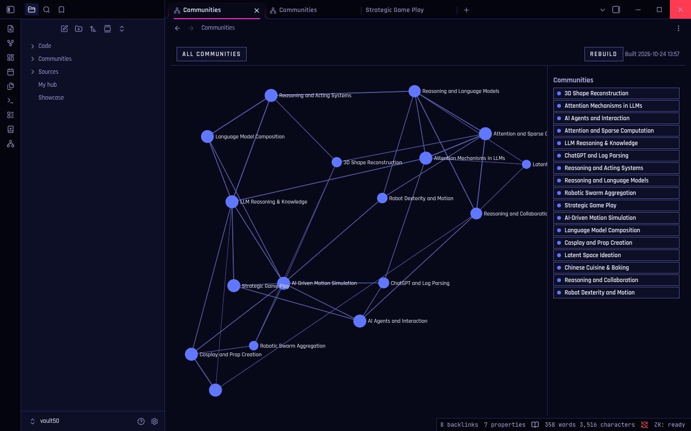
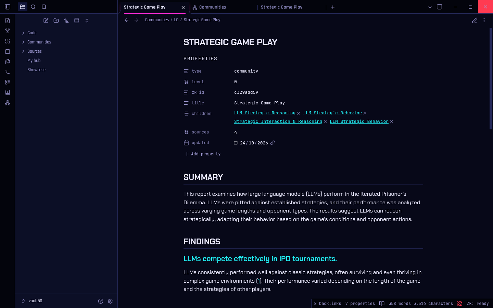
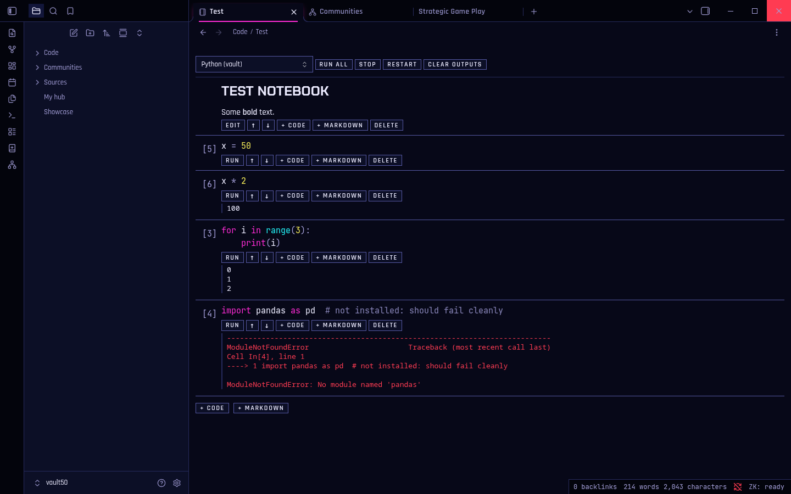
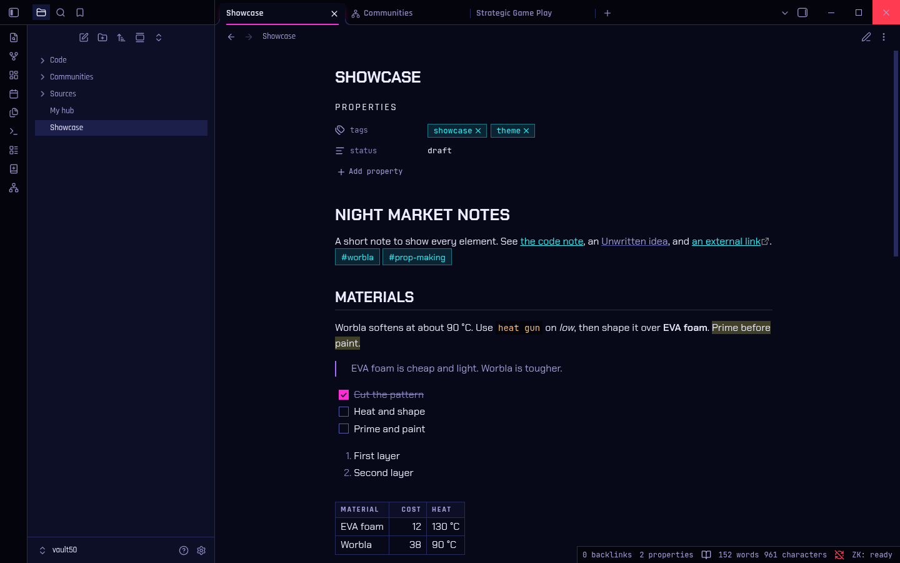

# Zettelkasten

An Obsidian plugin with a local Python service. It turns files and web pages into notes, runs code in place, and groups the ideas your notes share into communities. Everything runs on your machine.



- **Sources:** add a PDF, Word, Excel or PowerPoint file, or a web page. It's saved whole, its text is extracted, and your local model writes a summary. Each source gets a note with a reader and a space for your own notes.
- **Code:** code blocks marked `run` run in place through Jupyter kernels, with plots and tables inline. `.ipynb` notebooks open in their own view.
- **Communities:** GraphRAG-style groups of the ideas across your sources and notes, at two levels. Each group gets a note with a report that links to its sources. Rebuilds keep your notes.
- **NEONDECK:** a dark Obsidian theme from the same design system as [andrewrkane.com](https://andrewrkane.com). Every colour pair passes WCAG 2.2 AA.

Design: [Zettelkasten: Obsidian plugin or ground-up build?](https://andrewrkane.com/lab/zettelkasten-design). Spike results: `spike/REPORT.md`.

| | |
|---|---|
|  |  |
|  | |

## Status

Version 0.1.0. Tested on Linux with Obsidian 1.14, Ollama and an NVIDIA GPU. macOS and Windows should work but are untested. Not in Obsidian's community plugin list, because it needs the local service.

## Privacy

Nothing leaves your machine unless you point it somewhere. Summaries and reports go to the model API in the settings. That's Ollama on your own machine by default. The service listens on 127.0.0.1 only, with a new token each session. Web pages are fetched once, when you save them.

## Install

You need:

- Obsidian 1.5.7 or later, desktop.
- Python 3.12, [uv](https://docs.astral.sh/uv/), git and make. `make setup` installs Node into the project, so you don't need your own.
- [Ollama](https://ollama.com) with a model, or any OpenAI-compatible API. The default is `gemma3:27b`. A smaller model works, with weaker summaries.
- For web pages: Chromium or Chrome. Playwright's copy works too.
- For communities: a GPU helps a lot. GLiNER, which names each group's key ideas, needs PyTorch, which is several GB.

```sh
git clone https://github.com/arkane-dev/zettelkasten
cd zettelkasten
make setup                          # the service, its Python packages, Node and the plugin
make plugin                         # build the plugin
scripts/new-vault.sh ~/Zettelkasten # a new vault with the plugin and the theme
ollama pull gemma3:27b              # or set your own model in the settings
```

Open `~/Zettelkasten` in Obsidian with "Open folder as vault". Turn on community plugins when Obsidian asks. The status bar shows `ZK: ready` once the service is up. In the plugin settings, the model field says if your model isn't installed.

The theme works on its own too. Copy `theme/theme.css` and `theme/manifest.json` into `.obsidian/themes/NEONDECK/` in any vault, then pick NEONDECK under Appearance.

## How it works

```text
plugin/    Obsidian plugin (TypeScript, esbuild). Desktop only.
sidecar/   Python service (FastAPI, jupyter_client, graspologic). No UI, localhost only.
theme/     NEONDECK theme. build.mjs embeds the fonts and checks contrast.
scripts/   new-vault.sh, dev-obsidian.sh
spike/     Phase 0 experiments. Not part of the build.
```

The plugin starts the sidecar when the vault opens. The sidecar takes a free port on 127.0.0.1 and prints a ready line. Every request needs a token that's new each session. The sidecar exits when Obsidian closes, even if Obsidian crashes.

Model settings live in the plugin settings, per vault. Ollama is the default. Any OpenAI-compatible API works. Set the context length to match the model, since Ollama's OpenAI API can't change it per request. Long sources are split to fit.

## Sources

Add a PDF, Word, Excel, PowerPoint, HTML, Markdown or text file, or a web page. Use the ribbon, the "Add a source" command, drag and drop, or "Add as a source" on a file in the vault.

```text
Sources/<slug>/
  <Title>.md       the note: reader, summary, your notes
  original.pdf     or .docx, .xlsx, … or snapshot-2026-10-19.html for web pages
  content.md       extracted text, for search and GraphRAG
```

- Web pages are saved with SingleFile as one file, styles and images inlined. Scripts are blocked.
- "Capture this web page again" adds a dated snapshot. It never overwrites one, and adds nothing if the text hasn't changed.
- The summary sits between `<!-- zk:ai -->` markers, and "Summarise this source again" replaces only that. Software never touches `## Notes`.
- The same file or URL twice opens the source you already have.
- Text: PyMuPDF for PDFs, with OCR on pages that have no text. trafilatura for web pages. MarkItDown for Office files.
- Summaries are checked. Each claim is tested against the passages of the source that match it best. A contradicted claim is corrected, and one the source doesn't support is dropped. Reference lists and appendices are cut from papers first. On 18 spike documents this cut problem claims from about 6 per run to 2, judged by a second model (`eval/summary_eval.py`). It adds about 25% to the time a summary takes.

## Code

Add `run` after the language in a code block's fence line:

````markdown
```python run
x = 21
print(x * 2)
```
````

- **Buttons:** Run, Run all, Stop, Restart, Pin and Clear sit under each block. Blocks without `run` stay plain code.
- **Kernels:** one Jupyter kernel per note, so variables carry from block to block. Idle kernels stop after an hour.
- **Python:** each vault gets its own, in `.zk/python`, made with uv on the first run. Install packages from a block with `%pip install pandas`. To use another Python, set "Python for code" in the settings. It needs ipykernel.
- **Other languages:** any Jupyter kernel installed on the machine works. Its language becomes runnable, like ```` ```r run ````.
- **Output:** text, errors, images, HTML tables and Markdown. It's cached in `.zk/outputs/`, so the note stays clean.
- **Pin:** writes the output into the note, below the block, between `<!-- zk:output -->` markers. Images become attachments. Pinning again replaces it.
- **Commands:** "Run all code in this note", "Stop the running code", "Restart this file's kernel", "Clear code output in this note".

Notebooks (`.ipynb`) open in their own view: cells, outputs, a kernel picker, Run all, Stop and Restart. Click a code cell to edit it. Shift+Enter runs it and moves on. Ctrl+Enter runs it and stays. Outputs save into the file, which still opens in Jupyter. "New notebook" makes one.

## Communities

"Rebuild communities" reads every source and note, finds the ideas they share, and groups them. Each group gets a note in `Communities/L0/` (broad topics) or `Communities/L1/` (their sub-topics), with a report the model writes from the group's own text.

```text
Communities/
  L0/<Title>.md     summary, findings with links to their sources, key ideas, sources, sub-communities
  L1/<Title>.md
  _retired/         groups that went away, kept because you wrote in them
```

- **Method:** GraphRAG's fast method, reworked for a vault. Noun phrases (TextBlob) linked by co-occurrence, PMI weights, pruning, hierarchical Leiden with a fixed seed. Key ideas come from GLiNER, a small NER model, if it's installed. Reference lists are cut from PDFs first.
- **What it reads:** each source's text and your `## Notes` in it, your notes, and the Markdown cells of notebooks. Never the community notes, so the index doesn't feed on itself. One note is one chunk unless it's long.
- **Your notes stay:** a rebuild matches each group to last time's by shared phrases. A matched group keeps its id, its note and your `## Notes`. A group that's gone is deleted if you never wrote in it, or moved to `_retired/` if you did.
- **Only what changed:** extraction is cached per chunk. A report is rewritten only for a new group, or one whose members moved more than 20%. "Rebuild communities and rewrite every report" forces it.
- **When:** the command, or daily at the time in the settings (03:00 by default) if the vault changed. A missed night runs soon after Obsidian opens. The first build is always yours to start.
- **Graph:** "Open the community graph" shows the top-level groups. Click one to see its sub-groups and sources, and a sub-group to see its sources. Key ideas are listed beside it. The list has every item as a button, for the keyboard.
- **Names:** a note is named after its group's title. If a rewritten report changes the title, Obsidian renames the note, so your links follow. A note you renamed yourself keeps your name.
- **Cost:** on the spike's 50 documents (340 chunks), a first build takes about 14 minutes on an RTX 5090 with gemma3 27B, almost all of it the 92 reports. Editing one note and rebuilding takes about 35 seconds.

GLiNER needs PyTorch, several GB. `make setup` installs it. Without it, key ideas are the group's top phrases. The first build downloads NLTK's language data (about 15 MB) to `~/.cache/zk-sidecar`.

## Theme

NEONDECK for Obsidian: blue-black surfaces, neon used sparingly, cut corners, 1px lines, and Chakra Petch, Rajdhani and JetBrains Mono, embedded so they work offline. It's dark only. Light mode gets the same palette.

- **Contrast:** `make theme` rebuilds `theme/theme.css` and checks 45 colour pairs against WCAG 2.2 AA: text, code syntax, buttons, tags, focus. It fails the build on any miss. axe finds no colour problems in Obsidian with it.
- **Tokens:** the colours are NEONDECK's. If `sharable_assets/neondeck` is checked out next to this repo, the build checks they still match.
- **`prefers-contrast: more`** brightens lines and secondary text, and `prefers-reduced-motion` turns off transitions.

## Develop

Needs `uv` and Obsidian. Saving web pages needs Chromium: the system one, or Playwright's in `~/.cache/ms-playwright`.

```sh
make setup      # .venv with node, the sidecar, plugin packages
make test       # vitest and pytest
make theme      # rebuild the theme and check its contrast
make dev-vault  # dev-vault/ with the plugin symlinked
make obsidian   # open it in a separate Obsidian profile
make dev        # rebuild the plugin on every change
```

`make obsidian` uses its own profile in `.obsidian-dev/`, so it never touches your own vaults. Turn on community plugins once in that vault. After a rebuild, run "Reload app without saving" from the command palette.

## Licence

MIT, © 2026 Andrew R. Kane. The embedded fonts are under the SIL Open Font License 1.1: Chakra Petch (Cadson Demak), Rajdhani (Indian Type Foundry) and JetBrains Mono (JetBrains).
